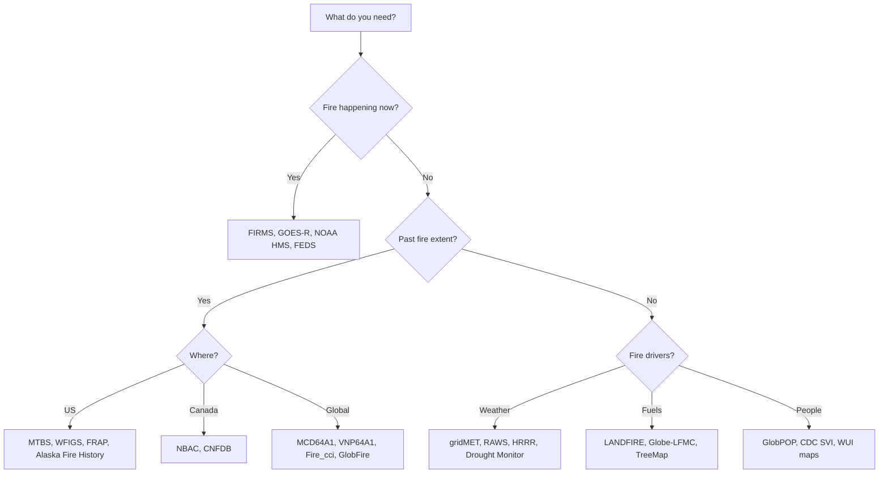

# Choosing a dataset

| Question | Start with | Theme |
| --- | --- | --- |
| Where is a fire burning right now? | FIRMS, GOES-R, NOAA HMS | [Active fire](../datasets/active-fire/index.md) |
| How big was a past fire and where did it burn? | MTBS, WFIGS, FRAP, NBAC, MCD64A1, VNP64A1 | [Perimeters](../datasets/perimeters/index.md) |
| How many fires, what caused them? | FPA-FOD, EFFIS | [Occurrence](../datasets/occurrence/index.md) |
| What will burn and how fast? | LANDFIRE, gridMET, RAWS, Globe-LFMC, US Drought Monitor | [Fuels](../datasets/fuels-terrain/index.md), [Weather](../datasets/weather-danger/index.md) |
| How bad is the smoke? | GFED, GFAS, AirNow | [Smoke](../datasets/smoke-emissions/index.md) |
| Which homes were lost? | CAL FIRE DINS | [Impacts](../datasets/impacts/index.md) |
| Where was prescribed fire used? | SE FireMap, FACTS, GlobalRx | [Prescribed fire](../datasets/prescribed-fire/index.md) |
| How did suppression go? | ICS-209-PLUS, fireline engagement | [Suppression](../datasets/suppression/index.md) |
| How fast did a fire spread? | Global Fire Atlas, FIRED, FEDS | [Fire behavior](../datasets/fire-behavior/index.md) |
| What started it? | GOES GLM, LIS/OTD | [Lightning](../datasets/lightning/index.md) |
| Who is most exposed? | GlobPOP, CDC SVI, FEMA NRI | [Social vulnerability](../datasets/social-vulnerability/index.md) |
| Which county, ecoregion, forest or GACC is this? | TIGER, EPA ecoregions, PAD-US, NIFC GACC | [Boundaries](../datasets/boundaries/index.md) |
| Training a model? | WildfireSpreadTS, Sen2Fire | [Benchmarks](../datasets/benchmarks-ml/index.md) |

## Trade-offs to check

- **Latency.** Geostationary data arrives in minutes. Polar-orbiting products take hours. Annual products lag by months.
- **Resolution.** Fine pixels miss nothing small but cover less history. Coarse products suit global trends.
- **Burn definition.** Perimeters, burned-area pixels and burn severity measure different things. Do not mix them without checking.
- **License.** Check terms before redistributing. Entries show the license the provider states.
